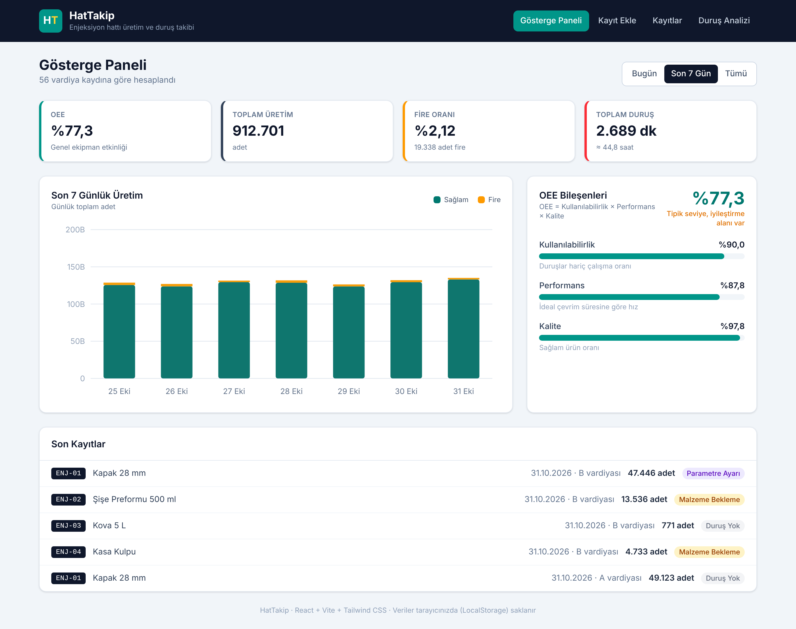
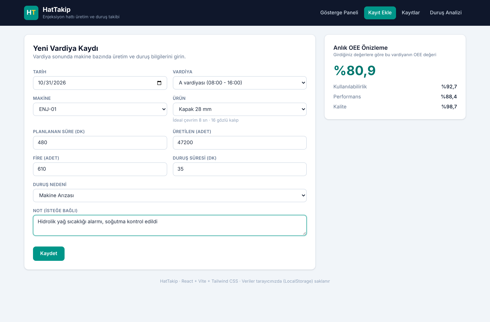
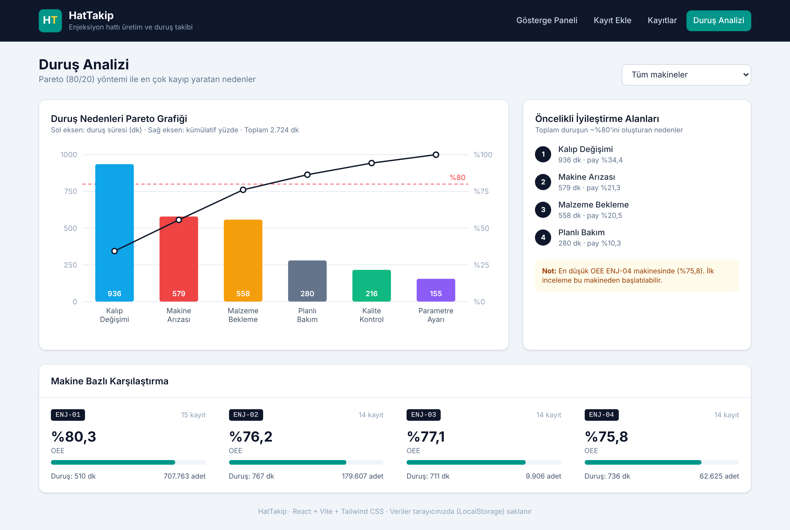
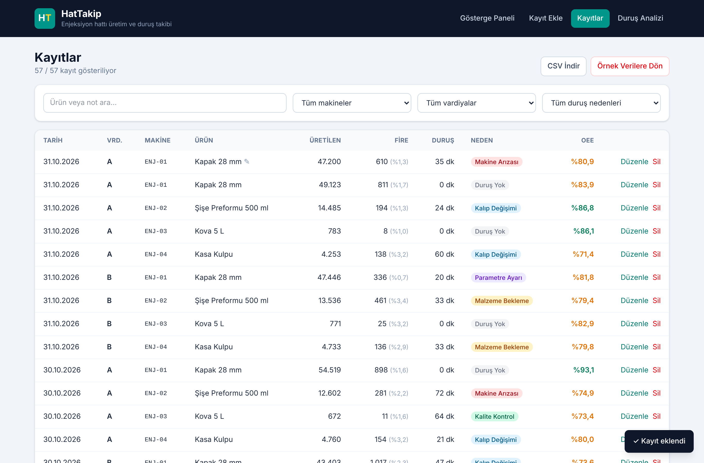

# HatTakip – Üretim Hattı Duruş ve Verimlilik Takibi

Plastik enjeksiyon hattında vardiya bazlı üretim, fire ve duruş kayıtlarını tutan; **OEE (Genel Ekipman Etkinliği)** değerini otomatik hesaplayan ve duruş nedenlerini **Pareto analizi** ile gösteren bir web uygulaması.

Bu proje, *Web Geliştirme; Yapay Zeka* eğitim programı kapsamında hazırlanmıştır. Fikir, bir plastik fabrikasında makine mühendisi olarak üretim hattında yaşadığım gerçek bir ihtiyaçtan çıktı: vardiya sonu duruş bilgileri çoğu zaman kağıda ya da dağınık Excel dosyalarına yazılıyor ve hangi nedenin en çok kayba yol açtığını görmek zorlaşıyor.

🔗 **Canlı demo:** https://hattakiplastik.netlify.app/



## Özellikler

- **Gösterge Paneli:** OEE, toplam üretim, fire oranı ve toplam duruş kartları; son 7 günün üretim grafiği (sağlam / fire); OEE bileşenleri (Kullanılabilirlik, Performans, Kalite).
- **Kayıt Ekle:** Tarih, vardiya, makine, ürün, planlanan süre, üretilen adet, fire, duruş süresi ve nedeni. Form doğrulaması ve girilen değerlere göre **anlık OEE önizlemesi**.
- **Kayıtlar:** Arama ve filtreleme (makine, vardiya, duruş nedeni), düzenleme / silme, duruş nedenlerine göre renkli rozetler, **CSV dışa aktarma** (Excel uyumlu).
- **Duruş Analizi:** Duruş nedenlerinin Pareto grafiği (%80 çizgisi ile), öncelikli iyileştirme alanları listesi ve makine bazlı OEE karşılaştırması.
- **LocalStorage:** Tüm veriler tarayıcıda saklanır. İlk açılışta son 7 güne ait örnek veriler yüklenir; "Örnek Verilere Dön" butonu ile sıfırlanabilir.
- Mobil uyumlu arayüz.

## OEE Nasıl Hesaplanıyor?

```
OEE = Kullanılabilirlik × Performans × Kalite

Kullanılabilirlik = (Planlanan süre − Duruş süresi) / Planlanan süre
Performans        = (Üretilen adet × İdeal çevrim süresi / Kalıp göz sayısı) / Çalışma süresi
Kalite            = (Üretilen − Fire) / Üretilen
```

Her ürün için ideal çevrim süresi ve kalıp göz sayısı `src/data/constants.js` dosyasında tanımlıdır.

## Kullanılan Teknolojiler

| Teknoloji | Kullanım amacı |
|---|---|
| React 19 | Arayüz bileşenleri ve state yönetimi (useState, useEffect) |
| Vite | Geliştirme sunucusu ve build |
| Tailwind CSS v4 | Stil |
| SVG | Grafikler (harici grafik kütüphanesi kullanılmadan elle çizildi) |
| LocalStorage | Veri saklama |
| Netlify | Yayınlama |

## Kurulum

```bash
git clone https://github.com/oztrksnn/hattakip.git
cd hattakip
npm install
npm run dev
```

Tarayıcıda `http://localhost:5173` adresini açın.

Production build için:

```bash
npm run build
```

## Proje Yapısı

```
src/
├── App.jsx                  # Sayfa geçişleri, kayıt ekleme/silme/düzenleme
├── components/
│   ├── Navbar.jsx
│   ├── Dashboard.jsx        # Gösterge paneli
│   ├── RecordForm.jsx       # Kayıt ekleme / düzenleme formu
│   ├── RecordList.jsx       # Kayıt tablosu, filtreler, CSV
│   ├── DowntimeAnalysis.jsx # Pareto ve makine karşılaştırması
│   ├── OeeBreakdown.jsx
│   ├── StatCard.jsx
│   ├── Toast.jsx
│   └── charts/
│       ├── DailyBarChart.jsx
│       └── ParetoChart.jsx
├── data/
│   ├── constants.js         # Makineler, ürünler, duruş nedenleri
│   └── sampleData.js        # Örnek veri üretimi
└── utils/
    ├── calculations.js      # OEE, Pareto ve özet hesapları
    ├── storage.js           # LocalStorage işlemleri
    └── date.js
```

## Yapay Zeka Kullanımı

Geliştirme sürecinde yapay zeka asistanı olarak **Claude** kullandım. Kullandığım aşamalar:

1. **Planlama:** Proje fikrini (enjeksiyon hattı için duruş takibi) anlattım; ekranları (panel, kayıt ekleme, liste, analiz) ve veri modelini (`tarih, vardiya, makine, urun, planlananDk, uretilen, fire, durusDk, durusNedeni, not`) birlikte belirledik.
2. **Bileşen üretimi:** Form, tablo ve kart bileşenlerinin ilk taslakları yapay zeka ile oluşturuldu, sonra alan adlarını ve metinleri kendi hattımızdaki terimlere göre düzenledim.
3. **Hesaplamalar:** OEE formülünü ben verdim; performans hesabında kalıp göz sayısının nasıl hesaba katılacağını ve Pareto için kümülatif yüzde hesabını yapay zeka ile birlikte yazdık.
4. **Grafikler:** Ek kütüphane kurmadan SVG ile çubuk ve Pareto grafiği çizmek için yardım aldım.
5. **Hata ayıklama:** `toISOString()` kullanıldığında gece yarısından sonra tarihin bir gün geri kaydığı hatayı yapay zeka ile tespit edip yerel tarih fonksiyonu (`utils/date.js`) yazdım. Ayrıca Pareto grafiğinde etiketlerin çizgiyle çakışması ve Tailwind'de özel `.girdi` sınıfının `sm:w-56` gibi sınıfları ezmesi (`@layer components` ile çözüldü) yapay zeka yardımıyla düzeltildi.
6. **Dokümantasyon:** Bu README dosyasının taslağı yapay zeka ile hazırlandı.

Örnek istemler:

> "React ve Tailwind ile vardiya kaydı formu yaz: tarih, vardiya, makine, ürün, üretilen, fire, duruş süresi ve nedeni olsun. Fire üretilenden büyükse hata göstersin."

> "Duruş nedenlerine göre Pareto grafiğini harici kütüphane kullanmadan SVG ile çiz, %80 çizgisi ve kümülatif yüzde çizgisi olsun."

Yapay zekanın ürettiği kodu doğrudan kullanmak yerine tarayıcıda test ederek kontrol ettim; özellikle OEE değerlerini elle hesaplayıp uygulamadaki sonuçla karşılaştırdım.

## Ekran Görüntüleri

| Kayıt Ekle | Duruş Analizi |
|---|---|
|  |  |



## Geliştirilebilecekler

- Vardiya hedeflerinin girilip gerçekleşen ile karşılaştırılması
- Ürün ve makine tanımlarının arayüzden eklenebilmesi
- Verilerin bir backend / veritabanında saklanması
